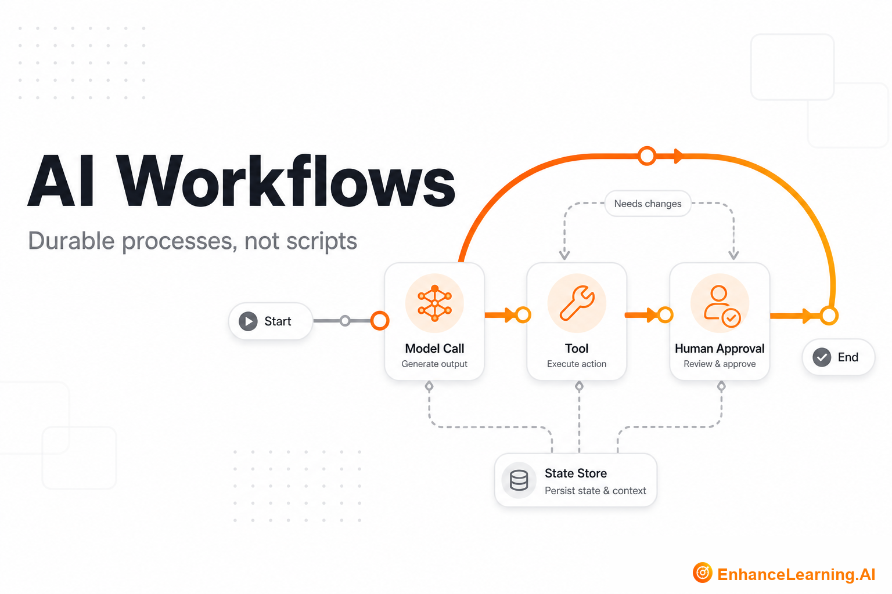

  

# AI Workflows: Durable Processes, Not Ad-Hoc Scripts With an LLM Inside

> Maintained reading path from [EnhanceLearning.AI](https://enhancelearning.ai) — practitioner-grade articles for engineers, architects, and technology leaders building production AI-native systems.

**Topic on the site:** [AI Workflows](https://enhancelearning.ai/articles?category=AI+Workflows) · **Full library:** [enhancelearning.ai/articles](https://enhancelearning.ai/articles)

## What this repo is

A curated reading path for **AI Workflows**. It is not a code SDK — it points to the foundation deep-dives on [EnhanceLearning.AI](https://enhancelearning.ai) so you can align on concepts, critique designs, and ship production systems that hold up.

Learn what makes a workflow AI-native, how orchestration differs from ad-hoc scripts, when workflow engines beat queues, and how to design reliable multi-step AI processes.

## Who it's for

Engineers automating business processes and platform teams providing orchestration primitives.

## Foundation articles

- [Single LLM Call vs Multi-Step AI Workflow](https://enhancelearning.ai/articles/single-llm-call-vs-multi-step-ai-workflow) — When one model invocation is enough versus when durable multi-step orchestration becomes necessary — the scope boundary for AI-native design.
- [What Makes a Workflow AI-Native Rather Than Just Automated](https://enhancelearning.ai/articles/what-makes-a-workflow-ai-native-rather-than-just-automated) — The architectural traits that separate AI-native workflows from script pipelines — probabilistic steps, judgment gates, and context that survives retries.
- [From Stateless API Calls to Stateful AI Workflows](https://enhancelearning.ai/articles/from-stateless-api-calls-to-stateful-ai-workflows) — Ephemeral API calls versus processes that accumulate context, decisions, and partial results — the baseline vocabulary for workflow design.
- [The Difference Between Orchestrated AI Workflows and Ad Hoc Scripts](https://enhancelearning.ai/articles/difference-between-orchestrated-ai-workflows-and-ad-hoc-scripts) — Formal workflow engines versus informal scripted automation — and how to recognize when orchestration infrastructure becomes necessary.
- [Designing Reliable AI Workflows](https://enhancelearning.ai/articles/designing-reliable-ai-workflows) — How to design AI workflows that survive retries, long-running steps, and human approval — with explicit state, idempotency, and failure paths you can operate.
- [AI Workflow Engines and Task Queues Are Not Interchangeable](https://enhancelearning.ai/articles/ai-workflow-engines-and-task-queues-are-not-interchangeable) — Workflow engines and task queues solve related but distinct problems — and conflating them loses durability, state, and approval capabilities.

## More from EnhanceLearning.AI

- Homepage: [https://enhancelearning.ai](https://enhancelearning.ai)
- All articles: [https://enhancelearning.ai/articles](https://enhancelearning.ai/articles)
- This topic filter: [AI Workflows](https://enhancelearning.ai/articles?category=AI+Workflows)
